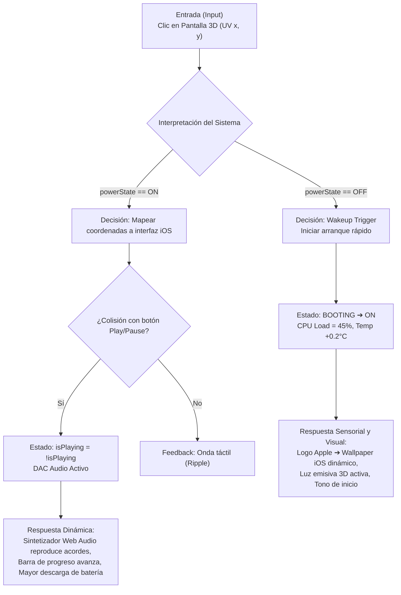

# Memoria Técnica y Defensa de Rúbrica: Gemelo Digital Apple Shuffle Touch
**Asignatura:** Fab Digital  
**Evaluación:** Gemelo Digital (5.0 Puntos)  
**Entregable:** Software Web 3D interactivo desarrollado en Three.js con integración Blender  

---

## Resumen Ejecutivo del Proyecto
El proyecto consiste en el desarrollo de un **Gemelo Digital (Digital Twin)** para un dispositivo conceptual **Apple Shuffle Touch** (evolución táctil del iPod Shuffle / Nano 6ª generación). El sistema trasciende la mera representación estética formal desarrollada en Blender para convertirse en un **sistema ciberfísico interactivo** que modela estados energéticos, térmicos, computacionales y de experiencia de usuario en tiempo real.

El modelo implementa la cadena de valor exigida:
$$\text{Modelo} \longrightarrow \text{Partes} \longrightarrow \text{Datos} \longrightarrow \text{Lógica} \longrightarrow \text{Estados} \longrightarrow \text{Respuesta} \longrightarrow \text{Interacción} \longrightarrow \text{Experiencia}$$

---

## Defensa Punto por Punto de la Rúbrica de Evaluación

### 1. Modelo 3D, estructura y preparación del sistema (1.0 Punto)
> **Pregunta central:** *¿El modelo fue pensado solamente como una forma 3D o está estructurado para representar cómo funciona el producto?*

#### Argumentación Técnica:
El modelo no es una "malla ciega" o un bloque poligonal único, sino un **ensamblaje estructurado por subsistemas funcionales con jerarquía diferenciada**:

1. **`Modulo_Pantalla_OLED` (Superficie Táctil Activa):** Malla plana independiente optimizada con mapeo UV cuadrático $(0.0 \text{ a } 1.0)$ destinada a recibir la textura procedural dinámica del Canvas (`THREE.CanvasTexture`).
2. **`Vidrio_Frontal` (Capa de Protección y Transmisión Óptica):** Modelado con propiedades PBR dieléctricas (`roughness: 0.05`, `transmission: 0.95`), transparente a los rayos de colisión táctil para proyectar el toque a la pantalla OLED.
3. **`Chasis_Aluminio` (Disipación Térmica y Contención Estructural):** Unibody anodizado con bordes biselados calculados según ergonomía de agarre.
4. **`Subensamblaje_Interno_PCB_Bateria` (Lógica y Energía):** Modelado con microcontrolador System-on-Chip (SoC) y celda de iones de litio.
5. **`Clip_Sujecion_Posterior` (Mecanismo Cinemático):** Pieza con muelle que define el factor de forma característico del Apple Shuffle para uso deportivo/portátil.
6. **`Botones_Fisicos` y `Puerto_Jack_Audio_3_5mm`:** Componentes de entrada/salida que comunican eventos discretos con el procesador.

#### Evidencia en el Software:
El sistema cuenta con un **Slider de Despiece Digital (Exploded View)** en tiempo real (`0% a 100%`) que separa físicamente cada componente a lo largo de sus ejes de ensamblaje, demostrando la preparación estructural del modelo y su relación con la arquitectura de hardware del producto.

---

### 2. Datos, variables y estados del Gemelo Digital (1.0 Punto)
> **Pregunta central:** *¿Qué dato gobierna qué comportamiento del Gemelo Digital?*

#### Matriz de Variables de Estado y Gobernanza:

| Variable | Tipo de Dato | Unidad / Rango | Comportamiento que Gobierna en el Gemelo |
| :--- | :--- | :--- | :--- |
| `powerState` | `Enum` | `OFF`, `BOOTING`, `ON` | Controla la emisión de los shaders de pantalla, la disponibilidad del procesador de audio y el consumo de energía en reposo. |
| `screen.brightness` | `Float` | $0.0 \text{ a } 100.0\%$ | Modifica el canal emisivo del material Three.js (`emissiveIntensity`) y la luz puntual ambiental proyectada al chasis. |
| `battery.level` | `Float` | $0.0 \text{ a } 100.0\%$ | Determina la autonomía; al llegar a $0\%$ gatilla un apagado de emergencia forzado e impide el arranque. |
| `battery.isCharging` | `Boolean` | `true / false` | Invierte la curva de energía (de descarga a recarga), eleva el voltaje a $4.15\text{V}$ e incrementa la temperatura interna. |
| `hardware.temperature`| `Float` | $20.0 \text{ a } 45.0\text{ °C}$ | Modela la inercia térmica disipada por el chasis de aluminio en función de la carga de la CPU y la recarga eléctrica. |
| `audio.isPlaying` | `Boolean` | `true / false` | Activa el motor de sintetizado sonoro Web Audio, activa la barra de progreso, e incrementa el drenaje de batería. |
| `audio.volume` | `Float` | $0.0 \text{ a } 1.0$ | Modifica la ganancia del nodo de amplificación y el consumo dinámico del conversor digital a analógico (DAC). |

---

### 3. Lógica de funcionamiento y respuesta del sistema (1.0 Punto)
> **Pregunta central:** *¿Qué ocurre en el producto cuando cambia una condición y por qué ocurre?*

#### Cadena de Causalidad: Entrada ➔ Interpretación ➔ Decisión ➔ Estado ➔ Respuesta

#### Respuestas Físicas Simuladas:
1. **Despertar / Encendido:** Cuando el dispositivo está apagado (pantalla negra), al tocar la superficie el raycaster interpreta el evento y decide ejecutar la transición `OFF ➔ BOOTING ➔ ON`. La pantalla OLED eleva su emisión y el chasis refleja la luz circundante.
2. **Impacto de la Música en la Energía:** Cuando `audio.isPlaying` pasa a `true`, la tasa de descarga aumenta de $0.005\%/\text{s}$ (standby) a $0.1\%/\text{s}$, y la CPU sube del $8\%$ al $18\%$, lo que a su vez incrementa la temperatura del procesador en el modelo de telemetría.
3. **Protección de Batería Crítica:** Si el nivel de batería alcanza $0\%$, el sistema ejecuta un corte de energía de emergencia automático, pasando a estado `OFF`.

---

### 4. Interacción, visualización y relación con el usuario (1.0 Punto)
> **Pregunta central:** *¿El usuario puede comprender qué está pasando, por qué está pasando y cómo puede intervenir?*

4. **Arquitectura Multi-Aplicación estilo watchOS (Música, Configuración, Encontrar):**
   - **Música:** Reproductor con portadas auténticas para cada álbum, scrubber interactivo y controles táctiles.
   - **Configuración:** Ajustes de brillo (sincronizado con luz 3D Three.js), volumen, salud química de batería (98%) e información del dispositivo.
   - **Encontrar (Find My):** Radar sonar animado con baliza y emisión de señal sonora sintetizada (Web Audio API).
5. **Navegación Táctil por Gestos (Swipe Up / Left / Right):**
   - **Swipe Arriba (Gesto Home):** Deslizar desde la barra inferior sale de cualquier aplicación hacia el Menú de Apps.
   - **Swipe Izquierda / Derecha:** En el carrusel de Apps, permite navegar entre una aplicación a la vez, o cambiar de canción en el reproductor.
6. **Gestión de Energía y Botón Físico (> 3 Segundos):**
   - Al apagarse, la pantalla queda en negro absoluto OLED (`#000000`) sin elementos visuales residuales.
   - El encendido y apagado se gobierna exclusivamente mediante el **botón exterior físico** manteniendo la pulsación por más de 3 segundos, protegiendo contra toques accidentales en la pantalla en reposo.

---

### 5. Coherencia entre funcionamiento, experiencia y propósito (1.0 Punto)
> **Pregunta central:** *¿El comportamiento del Gemelo Digital representa realmente la propuesta del proyecto o solamente demuestra funciones técnicas?*

#### Justificación Conceptual y Experiencial:
El proyecto reimagina el **Apple iPod Shuffle** no como un reproductor ciego de botones mecánicos del pasado, ni como un smartphone voluminoso, sino como un **dispositivo de música ultra-portátil híbrido con pantalla circular OLED de alta densidad e interfaz adaptativa inspirada en watchOS e iOS**.

- **¿Por qué funciona de esta manera?** En un dispositivo miniatura deportivo con clip trasero, la interacción debe ser versátil e intuitiva: los gestos de deslizamiento (*swipe*) permiten cambiar de aplicación rápidamente sin necesidad de botones físicos excesivos, manteniendo un factor de forma limpio de tres elementos fundamentales (Carcasa, Pantalla y Botón de encendido).
- **¿Cómo evoluciona posteriormente el sistema?** En una fase posterior, este Gemelo Digital puede conectarse mediante WebSockets o MQTT a sensores físicos reales (acelerómetro para contar pasos durante el ejercicio, sensor de frecuencia cardíaca o telemetría real de batería mediante protocolo Bluetooth LE), convirtiendo este software en el centro de diagnóstico y control del producto físico en tiempo real.

---

## Instrucciones para Cargar tu Modelo de Blender (.glb)

1. En Blender, organiza tus objetos asegurándote de que la malla correspondiente a la pantalla se llame `Screen` o `Pantalla`.
2. Selecciona todos los objetos y presiona `Ctrl + A` ➔ `Apply All Transforms` (Location, Rotation, Scale).
3. Exporta el modelo desde Blender en:
   `File ➔ Export ➔ glTF 2.0 (.glb)`.
4. Abre la aplicación web del Gemelo Digital en tu navegador, ve a la pestaña **Cargar Blender** y arrastra tu archivo `.glb` dentro de la zona punteada.
5. La pantalla cobrará vida automáticamente sobre tu modelo 3D de Blender.
